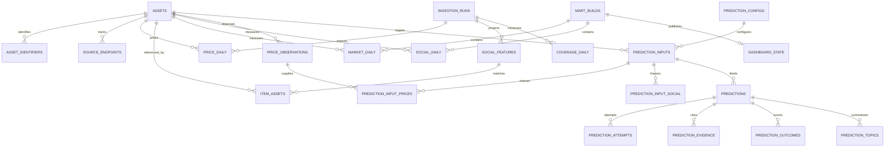

# 데이터 모델과 분석 계약

이 문서는 논리 스키마와 필수 제약조건을 정의한다. SQL 마이그레이션이나 실제 collection 생성 스크립트는 아니다. 전체 저장 책임은 [시스템 설계](system-design.md), 적재 순서는 [운영 문서](operations-and-validation.md)를 따른다.

## 1. 공통 식별자와 시간

| 항목 | 계약 |
|---|---|
| `asset_id` | 프로젝트 내부의 안정적인 문자열 ID. 화면용 ticker와 분리하며 최초 등록 후 변경하지 않음 |
| 외부 코인 ID | CMC ID와 chain/contract를 명시적 매핑으로 관리. symbol 단독 JOIN 금지 |
| 계약 주소 | EVM 비교 키는 소문자, 원본 주소도 보존. Solana 주소는 대소문자를 보존하고 그대로 비교 |
| 네이티브 자산 | DOGE처럼 계약이 없는 자산은 `kind=native`와 chain·native identifier로 표현. 가짜 계약 주소를 만들지 않음 |
| `item_key` | `platform:item_type:native_id`. 예: `x:post:123`, `reddit:submission:abc`, `reddit:comment:def` |
| 원본 플랫폼 ID | 항상 문자열. 큰 X ID의 부동소수점 손실 방지; Reddit submission/comment 충돌 방지 |
| `run_id` | 실행 UUID. 같은 실행의 재시도는 유지하며, 새로운 관측 실행에는 새 ID 사용 |
| `snapshot_id` | `SHA256(run_id, item_key, payload_sha256)`를 구분자 있는 정규 직렬화로 계산. 같은 입력 재적재는 같은 ID |
| `build_id` | 공개할 분석 결과 묶음의 UUID. 별도 입력 manifest와 연결 |
| `created_at` | 게시물의 사건 시각. PostgreSQL `TIMESTAMPTZ`, MongoDB UTC date |
| `fetched_at` | 우리 수집기가 응답을 받은 UTC 시각 |
| `source_observed_at` | 공급자가 원문을 관측했다고 명시한 시각. 알 수 없으면 null |
| `metrics_as_of` | 해당 반응 수의 공급자 관측 시각. 정확히 알 수 없으면 null이며 fetched_at으로 의미를 바꾸지 않음 |
| `available_at` | 해당 원본/가격 버전이 우리 시스템에서 확보·검증된 시각. 과거 게시일로 소급하지 않음 |
| `prediction_id` | 발행 전후 변하지 않는 예측 UUID. 입력·모델·프롬프트·대상일에 연결 |
| `event_date` | `created_at` 또는 가격 `timeOpen`의 UTC 날짜. 사용자 기기 시간대와 무관 |

문서·계약 주소·링크를 코인에 연결하는 규칙도 버전 관리한다. 다른 체인의 wrapped token은 검증된 매핑이 있을 때만 같은 `asset_id`를 사용한다. 익명 이용자의 계정을 외부 신원이나 지갑 소유자와 연결하지 않는다.

## 2. PostgreSQL 논리 테이블

가격과 분석 수치는 `NUMERIC`으로 적재해 원본의 작은 가격을 보존한다. 분석 라이브러리에 전달할 때만 필요한 범위에서 부동소수점으로 변환한다. PostgreSQL에 소셜 본문 전체나 공급자 payload를 JSON으로 복제하지 않는다.

| 테이블 | 기본 키 / 주요 제약 | 핵심 필드와 역할 |
|---|---|---|
| `assets` | PK `asset_id`; UNIQUE `cmc_id` | `symbol`, `display_name`, `quote_currency=USD`, `active` |
| `asset_identifiers` | PK `(kind, chain, normalized_identifier)`; FK `asset_id` | `raw_identifier`, 검증 근거 URI·시각. native/contract 구분 |
| `source_endpoints` | PK `endpoint_id`; FK `asset_id` | `scope_id`, platform, native account ID, raw/normalized URL, URL kind, 검증·접근 상태, 유효 기간, 근거 artifact |
| `ingestion_runs` | PK `run_id` | provider, scope, window, 시작·종료 시각, 상태, 건수, manifest/checkpoint URI, 오류 분류 |
| `price_daily` | PK `(asset_id, date)`; FK asset·run | OHLC, volume, market_cap, circulating_supply, 원본 시각, source_name, artifact URI·row·hash, 품질 플래그 |
| `social_features` | PK `item_key`; FK run | platform, item_type, created_at/event_date, context scope, language, sentiment, normalized_text_hash, content_status, snapshot_id, transform_version |
| `item_assets` | PK `(item_key, asset_id, match_kind)`; FK feature·asset | 매칭 근거, confidence, rule_version. 한 게시물에 여러 코인 허용 |
| `coverage_daily` | PK `(scope_id, date, run_id)`; FK run | 요청 구간, 실제 확인 구간, 상태, 관측 건수, 잔여 페이지·실패 사유, scope_version |
| `mart_builds` | PK `build_id` | 입력 manifest URI·해시, cutoff, 코드·설정·변환 버전, 상태, 생성·공개 시각 |
| `market_daily` | PK `(build_id, asset_id, date)`; FK build·asset | 해당 build의 종가·거래량·수익률·변동성·가격 품질 |
| `social_daily` | PK `(build_id, asset_id, date, platform, cohort)`; FK build·asset | observed_count, 분석용 eligible_count, 감성 유효 건수·평균, 7일 평균, 반복 비율, coverage_status·최신 관측 시각 |
| `dashboard_state` | PK `id=1`; nullable FK `published_build_id` | 공개 build 포인터. 트랜잭션으로 한 번에 변경; 최초 실행·철회 시 null 허용 |

### 예측용 추가 테이블

[예측 계약](prediction-design.md)에 따라 아래 관계를 추가한다. 원문 JSON을 PostgreSQL에 저장하는 대신 식별자·정규 컬럼과 연결 테이블을 사용한다.

| 테이블 | 키와 제약 | 주요 필드 |
|---|---|---|
| `price_observations` | PK `price_snapshot_id`; UNIQUE asset/date/payload hash/run | 수정 전 가격까지 보존하는 append-only OHLCV, fetched_at, available_at, 원본 URI·해시·row. price_daily는 현재값 투영 |
| `prediction_configs` | PK config_version | 고정 model ID/version, prompt URI/hash, feature/selection versions, cohort scope, token limits. 변경 시 새 버전 |
| `prediction_inputs` | PK input_id; FK asset/config | base_date, target_date, event_cutoff, input_cutoff, variant, input_hash, manifest URI, coverage, mode(prospective/replay/demo), created_at |
| `prediction_input_prices` | PK input_id/price_snapshot_id; FK 양쪽 | 정확한 가격 observation 선택 목록 |
| `prediction_input_social` | PK input_id/snapshot_id | Mongo snapshot·item key, 사용 역할(feature/text), available_at. DB 간 존재성은 작업에서 검증 |
| `predictions` | PK prediction_id; UNIQUE input_id/model_version/prompt_version | 방향(nullable UP/DOWN), 상태, rationale, issued_at, API request ID, artifact ID, latency, token usage, 비용. ABSTAIN은 direction=null + abstained |
| `prediction_attempts` | PK prediction_id/attempt_no; FK prediction | requested_at, response_at, status, artifact ID, API request ID, tokens, 비용. 최초 유효 예측만 발행 |
| `prediction_evidence` | PK prediction_id/item_key/snapshot_id | 입력에 포함된 근거만 허용, 표시 순서. 해당 input_social 관계와 앱 검증 |
| `prediction_topics` | PK prediction_id/topic_order; FK prediction | 입력 근거에 기반한 짧은 주제 label, 최대 3개. 전체 플랫폼의 trending 순위로 해석하지 않음 |
| `prediction_outcomes` | PK prediction_id/outcome_version; FK prediction·price observations | baseline/target price_snapshot_id, actual_direction(UP/DOWN/FLAT), correct(nullable), evaluated_at, scoring_version |

`prediction_inputs.target_date = base_date + 1 day`, 사건 마감 ≤ 입력 마감, prospective 발행 시각 ≤ 대상일 03:15 UTC를 검증한다. 입력의 모든 선택 관측은 available_at ≤ input_cutoff를 만족해야 한다. price_daily가 수정되어도 prediction_input_prices는 바뀌지 않는다. 최초 유효 예측은 재시도로 교체하지 않으며 설정 변경은 새 실험 버전이다. 모델 결과 저장 시 원 응답 artifact와 정규화 결과의 해시·ID가 일치해야 한다.

권장 조회 인덱스는 `predictions(issued_at)`, `prediction_inputs(asset_id,target_date,variant)`, `price_observations(asset_id,date,available_at)`다. 실제 쿼리 계획으로 확정한다.

`source_endpoints`에서 링크가 바뀌면 이전 행의 `valid_to`를 닫고 새로운 `endpoint_id` 행을 만든다. 같은 논리 계정/커뮤니티의 `scope_id`는 유지한다. 현재 활성 매핑의 중복은 `(asset_id, scope_id, platform)`에 대한 부분 UNIQUE 제약으로 방지한다. identity verification과 접근 허용·수집 가능 상태는 서로 다른 필드다.

`social_features`와 `item_assets`는 현재 탐색용 투영이며 새 snapshot/규칙으로 갱신할 수 있다. 과거 차트의 재현 입력은 build manifest의 snapshot ID 목록과 버전으로 고정한다. 차트가 현재 투영을 직접 읽어 과거 build와 섞지 않도록 한다.

가격 입력은 숫자 파싱 실패, 중복 키, OHLC 순서 오류를 격리한다. 0은 원문대로 보존하고 `zero_volume`, `zero_market_cap`, `zero_supply` 등으로 표시한다. 비양수 종가는 수익률 계산에서 제외한다. 날짜 누락을 선형 보간하거나 큰 수익률을 임의 제거하지 않는다.



최소 추가 인덱스는 `price_daily(date, asset_id)`, `social_features(event_date, platform)`, `item_assets(asset_id, item_key)`, `ingestion_runs(provider, started_at DESC)`, `coverage_daily(scope_id, date)`다. 기본 키와 중복되는 인덱스를 무조건 추가하지 않고 실제 SQL의 실행 계획으로 확인한다. 모든 PostgreSQL FK를 적용하되 MongoDB와의 연결은 DB 간 FK로 강제할 수 없으므로 별도 검증한다.

## 3. MongoDB collection

소셜 collection 두 개에 예측 artifact collection을 추가한다. 다음 JSON은 **가상의 정규화 예시**이며 FxTwitter의 실제 wire response나 수집된 게시물이 아니다. 실제 MongoDB 저장 시 시각은 BSON date로 변환하고, ID는 문자열로 유지한다. [JSON/BSON 구분](https://www.mongodb.com/resources/basics/json-and-bson)

### `social_items`: 현재 문서

```json
{
  "_id": "x:post:example-001",
  "schema_version": 1,
  "platform": "x",
  "item_type": "post",
  "native_id": "example-001",
  "created_at": "2026-09-01T12:00:00Z",
  "author_native_id": "example-account",
  "community": null,
  "title": null,
  "text": "Example text mentioning $BONK.",
  "parent_item_key": null,
  "referenced_item_keys": [],
  "media": [],
  "content_status": "available",
  "first_fetched_at": "2026-10-14T02:00:00Z",
  "last_fetched_at": "2026-10-14T02:00:00Z",
  "latest_snapshot_id": "example-snapshot",
  "last_run_id": "example-run"
}
```

Reddit submission은 `title`, `text`, `community`를 사용한다. comment는 개별 문서로 저장하고 `parent_item_key`와 `referenced_item_keys`로 부모·원글을 연결한다. 재게시와 인용은 참조 관계로 구분한다. 본문에 모든 댓글이나 매일의 관측 결과를 배열로 계속 붙이지 않는다.

### `social_observations`: 수집별 문서와 반응 수

```json
{
  "_id": "example-snapshot",
  "item_key": "x:post:example-001",
  "run_id": "example-run",
  "provider": "fxtwitter",
  "endpoint_id": "example-endpoint",
  "fetched_at": "2026-10-14T02:00:00Z",
  "available_at": "2026-10-14T02:00:01Z",
  "source_observed_at": null,
  "metrics_as_of": null,
  "metrics": {"likes": 12, "reposts": 2, "replies": 1},
  "source_payload": {"text": "Example text mentioning $BONK."},
  "raw_uri": "archive/fxtwitter/fetch_date=2026-10-14/example-run/page-0001.json.gz",
  "raw_sha256": "example-response-hash",
  "payload_sha256": "example-item-hash",
  "source_locator": "results[0]",
  "parser_version": "v1",
  "schema_version": 1
}
```

`raw_sha256`는 응답 본문 전체, `payload_sha256`는 정해진 정규 직렬화를 적용한 개별 item의 해시다. 배열 위치 등 `source_locator`로 원본 응답 안의 레코드를 찾는다. 같은 게시물을 여러 경로에서 발견해도 `social_items`는 하나이고 observations에 각 경로를 남긴다. 플랫폼 `x`와 데이터 제공자 `fxtwitter`는 다른 개념이다.

관측 문서는 일반적인 재수집으로 덮어쓰지 않는다. 삭제·보관 기간 처리 시에는 본문이 포함된 observation도 제거 또는 비식별화해야 한다. 불변 저장이라는 이유로 삭제 의무를 무시하지 않는다.

MongoDB 검증기는 필수 ID·시각·schema_version·열거값의 타입을 검증하고, source_payload의 플랫폼별 필드는 유연하게 허용한다. 배열 길이와 응답 크기를 제한하며 이상 문서를 quarantine으로 보낸다. `social_items`의 `_id` 고유성 외에 `(platform, created_at)`, `(community, created_at)` 인덱스를 둔다. observations에는 `(item_key, fetched_at DESC)`와 `(run_id, item_key)` 인덱스를 둔다. 초기에는 벡터 인덱스나 모든 payload 필드에 대한 인덱스를 만들지 않는다.

### `prediction_artifacts`: 동결한 모델 요청과 응답

`_id`, `prediction_id`, `attempt_no`, `input_id`, `request_payload`, `response_payload`, `request_hash`, `response_hash`, `requested_at`, `received_at`, `schema_version`, `model_version`, `prompt_version`를 저장한다. 요청 전문에는 실제 선택한 수치·본문과 snapshot ID가 들어간다. API 키·인증 헤더는 제외한다. 최초 요청과 재시도를 각각 보존하고, 삭제 대상 본문이 포함되면 소셜 원문과 함께 제거/비식별화한다. 예측 방향·평가 라벨은 SQL의 정규화된 결과를 정본으로 삼는다.

## 4. 코인 매칭과 cohort

| `match_kind` | 연결 기준 | 집계에서의 의미 |
|---|---|---|
| `verified_account` | 검증된 코인 계정이 직접 작성 | 선정 계정의 활동. 본문 직접 언급과는 별개 |
| `explicit_mention` | 고유 계약 주소, cashtag 또는 문맥 규칙으로 식별 | 해당 코인에 대한 직접 언급 후보 |
| `community_context` | 검증된 전용 커뮤니티의 게시물 | 문맥상 연결; 직접 언급 건수에 합치지 않음 |

confidence는 규칙 기반 점수이며 보정된 확률이라고 설명하지 않는다. 약어만 등장하는 모호한 사례는 자동 확정하지 않고 미분류/검토 대상으로 남긴다. `r/pepecoin`을 PEPE와 자동으로 연결하지 않는다. 다른 자산 PEP와의 혼동을 검증해야 한다.

차트 cohort는 `selected_account_original`, `community_direct`, `community_context`로 나눈다. 재게시는 별도 활동·참조로 표시하고 원작성자의 `created_at`을 재게시 사건 시각으로 사용하지 않는다. 재게시 시각을 확인할 수 없으면 해당 재게시의 일별 건수는 만들지 않는다. Reddit에서 발견한 X 링크는 발견 경로를 남기며 독립적인 전체 X 표본으로 취급하지 않는다.

하나의 item이 여러 규칙으로 같은 코인에 연결되면 cohort 내 `COUNT(DISTINCT item_key)`로 중복을 제거한다. 직접 언급과 커뮤니티 문맥은 배타적으로 분류해 두 cohort의 의미를 유지한다. 여러 코인을 언급한 item은 코인별 통계에 각각 포함할 수 있지만, 전체 게시물 수는 다시 distinct로 계산한다.

## 5. 일별 지표와 누락 처리

| 지표 | 정의 / 계산 조건 |
|---|---|
| 일별 수익률 | `close[t] / close[t-1] - 1`; UTC 기준 직전 달력일 가격이 있어야 함 |
| 30일 변동성 | 연속된 유효 일별 수익률 30개의 표본 표준편차 × `sqrt(365)`; 부족하면 null |
| `observed_count` | 삭제 제외, 실제 관측된 고유 item 수. partial에서도 하한 성격의 수치로 표시 가능 |
| `eligible_count` | 해당 범위의 수집을 완료한 날에만 분석에 사용. 실패·partial·unavailable은 null |
| 7일 활동 평균 | 연속 7일의 eligible_count가 모두 존재할 때 계산 |
| 평균 감성 | 지원되는 영어 원문 중 유효 점수의 산술평균. `sentiment_n`을 함께 저장 |
| 반복 콘텐츠 비율 | cohort·코인·일자 내 `1 - distinct(normalized_text_hash) / eligible_text_count`; 본문 없으면 null |
| 지연 상관 | `corr(social[t], return[t+k])`, `k=-7..7`; 양의 k는 소셜 이후 수익률, paired n≥30, 상수열이면 null |

VADER compound score를 영어 텍스트의 기초 감성값으로 사용한다. 버전과 전처리 규칙을 기록하고 금융적 강세/약세, 밈의 풍자·봇 여부와 동일시하지 않는다. 지연 범위를 사전에 고정하고 모든 lag와 표본 수를 함께 보여 주며 유리한 결과만 고르지 않는다.

`coverage_daily` 상태는 `not_checked`, `complete_for_scope`, `partial`, `failed`, `unavailable`이다. `complete_for_scope`는 설정한 계정·커뮤니티·API 범위를 처리했다는 뜻이며 플랫폼 전체의 완전성을 보장하지 않는다. 빈 결과라도 정상 종료와 범위 확인이 있을 때만 eligible_count=0을 허용한다. 제공자 오류·한도·불명확한 빈 결과는 null로 남긴다.

`social_daily`는 설정된 코인·플랫폼·cohort와 대상 달력일의 조합으로 행을 만든다. 비활성 소스도 해당 행에 unavailable과 null을 기록해 누락 행과 실제 0건을 구분한다. 아예 수집 대상으로 설정하지 않은 조합은 화면에서 “수집 대상 아님”으로 표시한다.

원문 정규화는 HTML entity 해제, Unicode·공백 정리, URL 토큰 치환을 하되 cashtag·emoji·부정어·강조 표현을 보존한다. 감성 입력에는 감성에 필요한 대문자·문장부호를 유지하고, 반복 검사용 해시는 별도 정규화 경로로 계산한다. 원본 본문은 수정하지 않는다. 언어 미지원·판별 불확실은 감성 null로 남긴다.

## 6. JOIN과 재현성

아래는 차트 조회의 개념 예시다. 여러 게시물과 가격을 직접 JOIN한 뒤 거래량을 SUM하지 않는다. 소셜은 먼저 일별로 집계하고, 단일 플랫폼·cohort를 선택한 뒤 가격과 결합한다.

```sql
SELECT m.date, m.asset_id, m.close, m.return_1d,
       s.observed_count, s.eligible_count, s.coverage_status
FROM dashboard_state AS d
JOIN market_daily AS m ON m.build_id = d.published_build_id
LEFT JOIN social_daily AS s
  ON s.build_id = m.build_id
 AND s.asset_id = m.asset_id
 AND s.date = m.date
 AND s.platform = 'x'
 AND s.cohort = 'selected_account_original'
WHERE d.id = 1 AND m.asset_id = :asset_id
ORDER BY m.date;
```

`:asset_id`는 설명용 바인딩 표기다. 구현에서는 DB 드라이버의 매개변수 바인딩을 사용한다. 여러 cohort를 동시에 표시하면 각 series로 분리하고 가격 거래량을 중복 합산하지 않는다.

build manifest는 사용한 원본 파일 해시, snapshot ID 목록, asset/endpoint registry 버전, 매칭·언어·감성 변환 버전, 코드 커밋, 기간을 기록한다. raw URI만 있고 checksum이 없거나 MongoDB snapshot을 찾을 수 없으면 추적 검증을 통과하지 못한다. 삭제 처리로 재현 입력이 제거된 경우에는 재현 불가 사유를 기록하고 원문을 복원하지 않는다.
