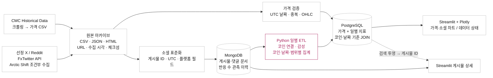
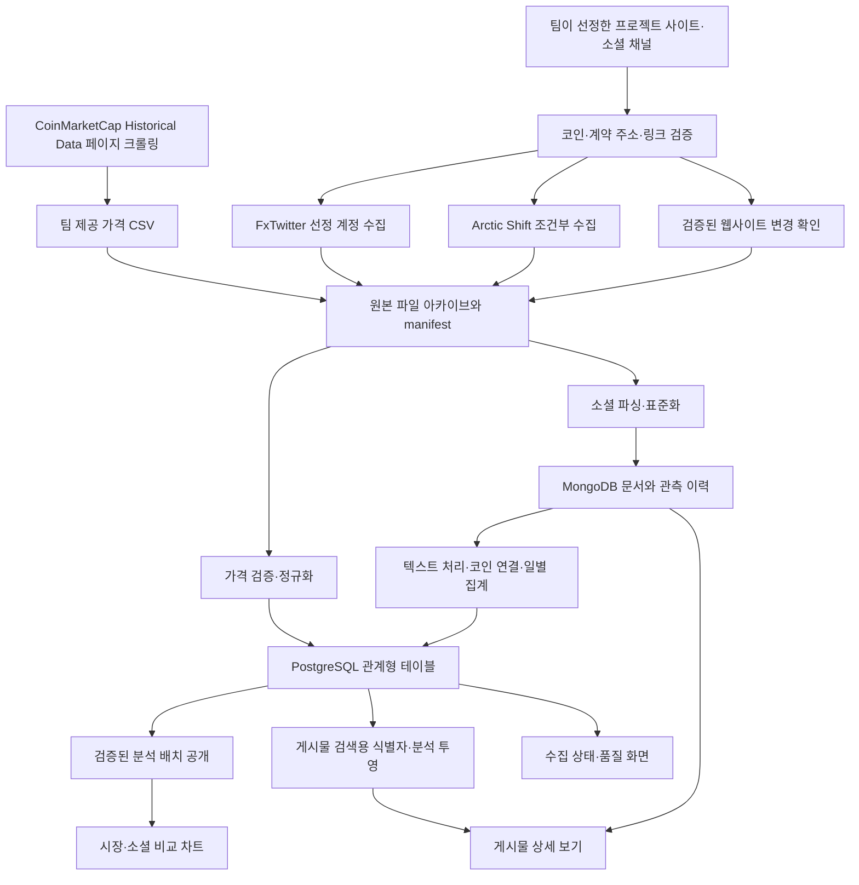

# 전체 시스템 설계

## 1. 목적과 범위

가격과 소셜 활동을 같은 시간축에 놓되, **무엇을 언제 어디에서 관측했는지 확인할 수 있는 대시보드**를 만든다. Data Engineering의 수집 → 전처리 → 저장 → 분석용 변환 → 애플리케이션 흐름을 구현하는 프로젝트다. 가격 예측 성능이나 투자 전략의 수익률을 입증하는 프로젝트로 정의하지 않는다.

현재 확보한 자료는 팀원이 CoinMarketCap Historical Data 페이지를 크롤링해 만든 10개 코인 가격 CSV 14,773행과 EDA 노트북이다. 소셜 API의 일부 호출 성공과 대규모 소셜 데이터 확보는 다른 상태다. 상세 근거는 [데이터 점검 기록](../proposal/evidence-and-references.md)에 있다.

| 영역 | 초기 범위 | 해석 범위 |
|---|---|---|
| 가격 | DOGE, SHIB, PEPE, MemeCore, PENGU, OFFICIAL TRUMP, SPX, BONK, FLOKI, 币安人生 | 고정된 10개 코인, 과거 시점별 상위 10개가 아님 |
| X | DOGE·SHIB·PEPE·BONK·SPX의 검증된 선정 계정 | 선정 계정의 관측 활동. 전체 X 언급량과 구분 |
| Reddit | r/dogecoin, r/SHIBArmy, r/Pepecryptocurrency 후보 | 정책·접근·코인 정체성 검증 이후 활성화 |
| 역사 비교 | 2026-07-01–2026-09-30을 초기 목표 구간으로 설정 | 소셜 확보 여부에 따라 실제 유효 구간을 표시 |
| 신규 관측 | 수집 시작 이후 일별 축적 | 현재 링크 상태·반응 수를 과거 관측값으로 소급하지 않음 |
| 언어·미디어 | 영어 텍스트, 미디어 URL·유형 메타데이터 | 이미지 다운로드·OCR·임베딩은 확장 |

가격은 2026-10-07까지만 제공되어 있다. 이후 소셜 데이터만 추가되면 최신 가격과의 결합은 불가능하므로 각 소스의 마지막 날짜와 실제 겹치는 구간을 표시한다. Reddit이 비활성인 상태에서도 가격·허용된 X 데이터로 핵심 기능을 시연한다.

## 2. 데이터 흐름과 구성 요소

### 발표용 전체 흐름

PPT 7장과 같은 개요다. **위쪽 가격 경로와 아래쪽 소셜 경로가 PostgreSQL의 분석 테이블에서 결합**된다. 각 화살표는 다음 단계로 전달하는 데이터의 방향이다. PostgreSQL의 차트·상태 조회와 MongoDB의 게시물 상세 조회는 서로 다른 읽기 경로다.

소셜은 일별 배치와 최근 7일 재조회, 월별 아카이브를 기본으로 한다. 가격 갱신에는 새 CSV 또는 팀원 크롤러 복원이 필요하다. Raw archive의 HTML은 선정 프로젝트 웹사이트의 검증 응답이며 MemeChain 데이터셋을 뜻하지 않는다. 실제 구현에서는 아래 상세 경로의 분석 배치 검증·공개 단계를 거친다. PPT에서는 읽기 경로를 간결하게 보여 주기 위해 SQL의 게시물 ID 선택 단계와 배치 공개 절차를 발표 노트로 설명한다.

### 상세 경로와 공개 경계

| 구성 요소 | 책임과 최소 인터페이스 |
|---|---|
| 수집기 | 소스·범위·시간 구간을 받아 원본 파일, 관측 메타데이터, 체크포인트 후보를 출력 |
| 원본 저장 | 응답 본문과 SHA-256, 요청 조건, 수집 시각을 연결. 인증 정보는 기록하지 않음 |
| 정규화 작업 | 원본 artifact를 입력받아 공통 식별자·시각·플랫폼 필드를 가진 문서로 변환 |
| MongoDB | 문서의 현재 상태와 관측별 payload를 저장. 텍스트 상세의 정본 |
| 변환 작업 | MongoDB의 지정 snapshot을 읽고 코인 연결·언어·감성·품질 플래그를 계산 |
| PostgreSQL | 관계와 제약조건, 현재 검색 투영, 버전별 일별 분석 결과를 저장 |
| 공개 작업 | 완성된 build를 검증한 뒤 공개 포인터를 트랜잭션으로 변경 |
| Streamlit | 차트는 공개 build의 SQL 결과, 상세는 게시물 ID에 해당하는 MongoDB 문서를 조회 |

초기에는 별도 REST API를 만들지 않는다. Streamlit의 서버 코드가 읽기 전용 DB 계정으로 접근하며 사용자 브라우저가 DB에 직접 연결하지 않는다. API를 분리하는 것은 여러 클라이언트가 생긴 이후의 확장이다.

## 3. DB 선택 결정 기록

**결정: PostgreSQL + MongoDB + 파일 아카이브.**

PostgreSQL은 JSON과 JSONB를 지원하므로 소셜 문서를 저장할 수 있다. 단일 PostgreSQL 구성도 타당한 대안이다. JSON은 표현 형식이며 NoSQL이라는 DB 종류를 뜻하지 않는다. [PostgreSQL 공식 문서](https://www.postgresql.org/docs/current/datatype-json.html)

| 대안 | 장점 | 이 프로젝트에서의 판단 |
|---|---|---|
| PostgreSQL의 관계형 테이블 + JSON/JSONB | DB 하나로 운영·백업·트랜잭션을 관리 | 운영 단순성이 가장 큰 장점. 비교 대안으로 명시 |
| PostgreSQL + MongoDB | 소셜 문서와 관계형 분석의 책임을 구분하고 두 모델 사이 ETL을 구현 | 채택. 추가 운영 비용을 감수하는 교육·모델링 결정 |
| MongoDB만 사용 | 모든 입력을 문서로 다룰 수 있음 | 가격과 코인 관계, SQL 분석을 보여주려는 목적에 비해 이점이 작음 |

MongoDB는 X의 인용·미디어 정보와 Reddit의 제목·본문·댓글 관계처럼 플랫폼마다 다른 문서를 관리한다. 한 게시물과 함께 읽는 작은 메타데이터는 중첩하고, 계속 증가하는 댓글·관측 이력은 별도 문서로 둔다. 필드가 유연하더라도 식별자·시각·버전에는 검증을 적용한다. [MongoDB 모델링 문서](https://www.mongodb.com/docs/manual/data-modeling/)

채택 이유는 세 가지다. 첫째, 플랫폼별 구조 차이를 문서 모델에 유지할 수 있다. 둘째, 게시물 상세와 일별 분석이 서로 다른 읽기 경로를 갖는다. 셋째, 수업에서 다루는 관계형·문서형 모델과 그 사이의 ETL을 실제로 설계하고 평가할 수 있다.

텍스트가 NoSQL을 필수로 만들거나 이미지가 있어야 MongoDB를 쓸 수 있는 것은 아니다. 또한 MongoDB가 PostgreSQL보다 항상 빠르다는 성능 주장을 하지 않는다. 현재 가격 데이터 규모만으로 DB 두 개가 필요하다고 설명하지 않는다. 강의도 문서 모델과 저장 엔진을 구분하므로, 그 구분에 맞춰 선택 근거를 제시한다.

비용은 서비스 두 개의 운영·인덱스·백업과 DB 간 일관성 관리다. 이를 제한하기 위해 단일 배치 작성자, 안정적인 게시물 ID, MongoDB 정본 → PostgreSQL 파생 데이터의 한 방향 흐름, 버전별 분석 결과 공개를 사용한다. 두 DB를 아우르는 분산 트랜잭션은 도입하지 않는다.

## 4. 저장 책임과 일관성 경계

소셜 본문과 공급자별 원문 필드는 MongoDB가 소유한다. PostgreSQL에는 본문 전체를 JSON 컬럼으로 중복 보관하지 않고 식별자·코인 연결·수치 지표·품질 상태만 둔다. PostgreSQL JSON을 금지하는 일반 원칙을 주장하는 것은 아니며, 이 프로젝트의 정본 위치를 명확히 하는 결정이다.

원본 응답 파일은 MongoDB와 별도로 보관한다. JSON을 파싱해서 BSON으로 저장한 결과는 받은 응답의 공백·키 순서 등을 그대로 보존하는 원본 바이트가 아니다. 파일 아카이브는 재처리의 입력이고 MongoDB는 조회·변환을 위한 문서 저장소다. 원본 보존에도 삭제·보관 기간 정책이 적용된다.

공개된 차트는 하나의 `build_id`를 사용한다. 현재 가격 테이블이나 처리 중인 소셜 투영을 직접 결합해 화면을 만들지 않는다. 게시물 탐색은 **현재 처리된 문서 상태**를 보여주므로 차트 build의 기준 시각과 다를 수 있으며 상세 관측 시각을 표시한다. 과거 build의 재현에는 해당 build manifest에 기록된 snapshot을 사용한다. 삭제된 콘텐츠는 과거 build에서도 다시 노출하지 않는다.

수집 범위, 매칭 규칙, 감성 모델 버전이 바뀌면 새 build를 만든다. 소스 간 일별 자료가 다르게 늦어질 수 있으므로 화면에는 전체 갱신 시각 외에도 소스별 최신 사건일·수집일을 표시한다.

## 5. 화면과 분석 질문

| 화면 | 사용자 기능 | 조회 경로 |
|---|---|---|
| Market overview | 10개 코인 종가·거래량·수익률·변동성, 비교 기간 선택 | PostgreSQL `market_daily` |
| Price–social comparison | 코인·소스·cohort별 활동과 가격 비교, 지연 상관, 표본 수 | PostgreSQL 두 daily mart를 날짜·코인 기준으로 결합 |
| Post explorer | 코인·기간·플랫폼·매칭 유형 필터, 출처와 게시물 상세 | PostgreSQL 투영으로 ID 선택 → MongoDB 조회 |
| Data health | 소스 활성 상태, 수집 오류, 커버리지, 최신 가격일, 품질 플래그 | PostgreSQL 실행·커버리지 테이블 |

X의 선정 계정 게시물, Reddit의 직접 언급, 커뮤니티 문맥에 따른 연결, 재게시를 구별한다. 서로 다른 모집단의 건수를 합쳐 하나의 “전체 관심도”로 표시하지 않는다. 소셜 감성은 언어적 긍정·부정의 기초 지표로 표현하고 금융적 강세·약세와 동일시하지 않는다.

## 6. 실행 환경과 확장

Python·pandas로 처리하고 PostgreSQL·MongoDB·Streamlit을 Docker Compose 서비스로 구성한다. 원본과 DB는 서로 다른 영속 볼륨을 사용한다. DB 포트는 외부에 공개하지 않는다. 의존성과 이미지 버전은 첫 구현 시 지원되는 고정 버전으로 잠그고 실행 manifest에 기록한다. 현재 문서는 실행 환경을 설치한 결과가 아니다.

초기 비용 목표는 외부 유료 API 없이 로컬 실행하는 것이다. 로컬 디스크·백업·실행 시간은 여전히 자원 비용이며, 무료 호스팅의 지속성은 가정하지 않는다. 기본 스케줄은 [운영 문서](operations-and-validation.md)에 정의한다.

이미지 저장은 향후 파일·객체 저장소로 분리하고 DB에는 URI·해시·메타데이터를 둔다. OCR·임베딩·LLM 요약은 권한과 품질을 확인한 뒤 추가한다. Telegram·Discord 등은 공개 링크가 있다는 사실과 메시지를 수집할 권한·기술 경로가 있다는 사실을 구분해 검토한다. 현재 MVP에 Kafka, 별도 검색 서버, 벡터 DB, 분산 처리 프레임워크는 필요하지 않다.
