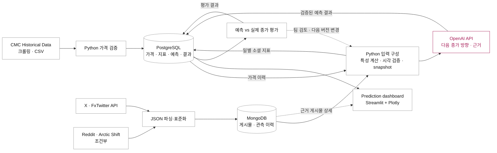

# 전체 시스템 설계

## 1. 목적과 범위

**가격과 소셜 데이터를 결합해 다음 UTC 일별 종가의 상승·하락을 예측하고, 근거와 실제 결과를 보여주는 대시보드**를 만든다. OpenAI API 추론을 핵심 단계로 포함한다. 수집·전처리·SQL/NoSQL 저장·입력 스냅샷·예측·평가·화면까지 구현하며, 예측 성능은 구현 후 검증할 가설이다. 구체적인 대상·마감 시각·비교군은 [예측 설계](prediction-design.md)에 정의한다.

현재 확보한 자료는 팀원이 CoinMarketCap Historical Data 페이지를 크롤링해 만든 10개 코인 가격 CSV 14,773행과 EDA 노트북이다. 소셜 API의 일부 호출 성공과 대규모 소셜 데이터 확보는 다른 상태다. 상세 근거는 [데이터 점검 기록](../proposal/evidence-and-references.md)에 있다.

| 영역 | 초기 범위 | 해석 범위 |
|---|---|---|
| 가격 | DOGE, SHIB, PEPE, MemeCore, PENGU, OFFICIAL TRUMP, SPX, BONK, FLOKI, 币安人生 | 고정된 10개 코인, 과거 시점별 상위 10개가 아님 |
| X | DOGE·SHIB·PEPE·BONK·SPX의 검증된 선정 계정 | 선정 계정의 관측 활동. 전체 X 언급량과 구분 |
| Reddit | r/dogecoin, r/SHIBArmy, r/Pepecryptocurrency 후보 | 정책·접근·코인 정체성 검증 이후 활성화 |
| 역사 비교 | 2026-07-01–2026-09-30을 초기 목표 구간으로 설정 | 소셜 확보 여부에 따라 실제 유효 구간을 표시 |
| 신규 관측 | 수집 시작 이후 일별 축적 | 현재 링크 상태·반응 수를 과거 관측값으로 소급하지 않음 |
| 예측 | DOGE·SHIB·PEPE·BONK·SPX의 다음 일별 종가 방향 | 가격+소셜과 가격 전용 입력을 비교, 신규 발행 결과를 전향 평가 |
| 언어·미디어 | 영어 텍스트 우선, 미디어 URL·유형과 표시 가능한 밈 | 이미지 기반 예측·OCR·임베딩은 확장 |

가격은 2026-10-07까지만 제공되어 있다. 이후 소셜 데이터만 추가되면 최신 가격과의 결합은 불가능하므로 각 소스의 마지막 날짜와 실제 겹치는 구간을 표시한다. Reddit이 비활성인 상태에서도 가격·허용된 X 데이터로 핵심 기능을 시연한다.

## 2. 데이터 흐름과 구성 요소

### 발표용 전체 흐름

PPT 4장에서 수집 출처·방법을 설명하고 **5장**에서 아래 전체 파이프라인을 보여준다. 사용자 화이트보드 스케치의 가격 상단 경로, 소셜 하단 경로, 가운데 AI 분석, 오른쪽 대시보드를 따른다. 저장과 분석 단계를 구별하고 화살표에 전달 내용을 표시한다.

도식의 PostgreSQL은 하나의 서비스다. 가격 입력과 예측 결과는 서로 다른 테이블이며, 가격을 AI 결과로 덮어쓰지 않는다. 가격 입력을 읽는 경로와 예측 결과를 쓰는 경로의 왕복을 자동 학습으로 표현하지 않는다. 피드백은 실제 종가와 예측을 비교한 뒤 팀이 다음 버전의 규칙·프롬프트를 수정하는 절차다.

기존의 큰 `Raw archive` 상자는 발표 본선에서 제외한다. CSV·JSON은 수집 결과 형식으로 표시하고 원본 파일 보관은 보조 경로로 설명한다. 원본 파일·체크섬·manifest 정책은 유지하며, 파일 저장소와 MongoDB에 저장한 문서를 혼동하지 않는다. MemeChain은 입력 노드가 아니라 수집 대상 선정의 참고 자료다.

### 처리와 공개 경계

| 구성 요소 | 책임과 입출력 |
|---|---|
| 수집기 | CMC 크롤링 CSV와 eligible social API JSON을 확보하고 원본·관측 시각·해시·checkpoint 기록 |
| MongoDB | 게시물/댓글 현재 상태, 관측별 payload, 모델 요청·응답 문서. 본문 정본 |
| Python ETL | 가격 검증, ID·UTC 정규화, 코인 연결, 소스별 일별 지표. 먼저 집계하고 가격과 JOIN |
| 입력 구성 | 사건 마감과 실제 가용 시각을 통과한 가격 버전·social snapshot만 선택하고 입력을 동결 |
| OpenAI API | 제공한 가격·소셜 입력으로 UP/DOWN/ABSTAIN 및 짧은 근거를 생성. 웹 검색·DB 도구 없이 호출 |
| 결과 검증 | 스키마·근거 ID·예측 시각·재시도 키 검사. 실패와 보류를 방향값으로 대체하지 않음 |
| PostgreSQL | 자산·가격·분석 mart·예측·근거 연결·실제 결과·운영 메타데이터 |
| 평가 작업 | 다음 종가 확보 후 결과 추가. 원 예측은 불변. 지표와 오류를 다음 실험 설정 검토에 사용 |
| Streamlit | SQL에서 가격·예측·성과를 조회하고 MongoDB에서 근거 본문 조회. 화면 갱신으로 추론하지 않음 |

원본 → 관측 저장 → ETL → 검증된 mart 공개 순서를 지킨다. 예측은 별도 input snapshot과 검증 결과를 가진 독립 레코드로 발행하므로, 차트 build를 바꿔도 과거 예측의 입력이 바뀌지 않는다. 예측의 structured fields와 evidence ID를 한 SQL 트랜잭션으로 확정하고 원 요청·응답 문서의 해시를 연결한다. 실패 시 새 예측은 unavailable, 이전 예측은 원 대상일로 남긴다.

초기에는 별도 REST API를 만들지 않는다. Streamlit 서버가 읽기 전용 DB 계정으로 접근하고, 배치 작업만 서버 측 OpenAI API 자격 증명을 사용한다. 사용자 브라우저에 DB나 모델 API 키를 전달하지 않는다.

## 3. DB 선택 결정 기록

**결정: PostgreSQL + MongoDB + 파일 아카이브.**

PostgreSQL은 JSON과 JSONB를 지원하므로 소셜 문서를 저장할 수 있다. 단일 PostgreSQL 구성도 타당한 대안이다. JSON은 표현 형식이며 NoSQL이라는 DB 종류를 뜻하지 않는다. [PostgreSQL 공식 문서](https://www.postgresql.org/docs/current/datatype-json.html)

| 대안 | 장점 | 이 프로젝트에서의 판단 |
|---|---|---|
| PostgreSQL의 관계형 테이블 + JSON/JSONB | DB 하나로 운영·백업·트랜잭션을 관리 | 운영 단순성이 가장 큰 장점. 비교 대안으로 명시 |
| PostgreSQL + MongoDB | 소셜 문서와 관계형 분석의 책임을 구분하고 두 모델 사이 ETL을 구현 | 채택. 추가 운영 비용을 감수하는 교육·모델링 결정 |
| MongoDB만 사용 | 모든 입력을 문서로 다룰 수 있음 | 가격과 코인 관계, SQL 분석을 보여주려는 목적에 비해 이점이 작음 |

MongoDB는 X의 인용·미디어 정보와 Reddit의 제목·본문·댓글 관계처럼 플랫폼마다 다른 문서를 관리한다. 한 게시물과 함께 읽는 작은 메타데이터는 중첩하고, 계속 증가하는 댓글·관측 이력은 별도 문서로 둔다. 필드가 유연하더라도 식별자·시각·버전에는 검증을 적용한다. [MongoDB 모델링 문서](https://www.mongodb.com/docs/manual/data-modeling/)

채택 이유는 세 가지다. 첫째, 플랫폼별 구조 차이를 문서 모델에 유지할 수 있다. 둘째, 게시물 상세와 일별 분석이 서로 다른 읽기 경로를 갖는다. 셋째, 수업에서 다루는 관계형·문서형 모델과 그 사이의 ETL을 실제로 설계하고 평가할 수 있다.

텍스트가 NoSQL을 필수로 만들거나 이미지가 있어야 MongoDB를 쓸 수 있는 것은 아니다. 또한 MongoDB가 PostgreSQL보다 항상 빠르다는 성능 주장을 하지 않는다. 현재 가격 데이터 규모만으로 DB 두 개가 필요하다고 설명하지 않는다. 강의도 문서 모델과 저장 엔진을 구분하므로, 그 구분에 맞춰 선택 근거를 제시한다.

비용은 서비스 두 개의 운영·인덱스·백업과 DB 간 일관성 관리다. 이를 제한하기 위해 단일 배치 작성자, 안정적인 게시물 ID, MongoDB 정본 → PostgreSQL 파생 데이터의 한 방향 흐름, 버전별 분석 결과 공개를 사용한다. 두 DB를 아우르는 분산 트랜잭션은 도입하지 않는다.

## 4. 저장 책임과 일관성 경계

소셜 본문과 공급자별 원문 필드는 MongoDB가 소유한다. PostgreSQL에는 본문 전체를 JSON 컬럼으로 중복 보관하지 않고 식별자·코인 연결·수치 지표·품질 상태와 정규화한 예측·근거 요약을 둔다. PostgreSQL JSON을 금지하는 일반 원칙을 주장하는 것은 아니며, 이 프로젝트의 정본 위치를 명확히 하는 결정이다.

원본 응답 파일은 MongoDB와 별도로 보관한다. JSON을 파싱해서 BSON으로 저장한 결과는 받은 응답의 공백·키 순서 등을 그대로 보존하는 원본 바이트가 아니다. 파일 아카이브는 재처리의 입력이고 MongoDB는 조회·변환을 위한 문서 저장소다. 원본 보존에도 삭제·보관 기간 정책이 적용된다.

공개된 차트는 하나의 `build_id`를 사용한다. 현재 가격 테이블이나 처리 중인 소셜 투영을 직접 결합해 화면을 만들지 않는다. 게시물 탐색은 **현재 처리된 문서 상태**를 보여주므로 차트 build의 기준 시각과 다를 수 있으며 상세 관측 시각을 표시한다. 과거 build의 재현에는 해당 build manifest에 기록된 snapshot을 사용한다. 삭제된 콘텐츠는 과거 build에서도 다시 노출하지 않는다.

수집 범위, 매칭 규칙, 감성 모델 버전이 바뀌면 새 build를 만든다. 소스 간 일별 자료가 다르게 늦어질 수 있으므로 화면에는 전체 갱신 시각 외에도 소스별 최신 사건일·수집일을 표시한다.

## 5. 화면과 분석 질문

| 화면 영역 | 사용자 기능 | 조회 경로 |
|---|---|---|
| 코인·기간 선택 / 가격 차트 | 10개 코인 가격 탐색, 선택 코인의 기준일·가격 확인 | PostgreSQL market_daily |
| 다음 종가 예측 | 방향, 발행/대상 시각, 사용 모델/입력 variant, 보류 사유 | PostgreSQL predictions·prediction_inputs |
| AI 근거 / 주요 주제 | 짧은 근거, 관측 소스 범위, 실제 입력에 포함된 게시물로 이동 | SQL prediction_evidence → MongoDB observations |
| 밈 미리보기 | 출처·관측 시각을 표시한 관련 미디어 | MongoDB media metadata / 허용된 이미지 URI |
| 과거 예측 결과 | 예측과 실제 방향, 비교군, 표본 수, 미평가·실패 상태 | PostgreSQL prediction_outcomes |
| 데이터 상태 | 최신 가격일, 수집 오류·scope coverage·예산 상태 | PostgreSQL 운영 테이블 |

PPT 마지막 장은 위 영역을 하나의 서비스 화면으로 배치한 목업이다. 가격 차트는 제공 자료를 사용하고, 예측·주제·근거는 예시 표시를 붙인다. 실측하지 않은 적중률과 모델 신뢰 확률은 만들지 않는다. UI 속 밈 이미지가 초기 예측의 이미지 입력을 뜻하지 않는다.

선정 계정과 커뮤니티 표본의 범위를 표시하고 전체 시장 여론으로 확대 해석하지 않는다. 감성의 긍정·부정과 가격 방향은 별도 변수다. 과거 예측 성과는 당시 고정한 입력·결과의 평가이며 현재 수정된 데이터로 소급 재작성하지 않는다.

## 6. 실행 환경과 확장

Python·pandas로 처리하고 PostgreSQL·MongoDB·Streamlit을 Docker Compose 서비스로 구성한다. 원본과 DB는 서로 다른 영속 볼륨을 사용한다. DB 포트는 외부에 공개하지 않는다. 의존성과 이미지 버전은 첫 구현 시 지원되는 고정 버전으로 잠그고 실행 manifest에 기록한다. 현재 문서는 실행 환경을 설치한 결과가 아니다.

수집은 무료 접근 가능한 경로를 우선하지만 OpenAI API 추론 비용은 별도로 발생한다. 모델·호출량·일별 예산 상한을 구현 전에 설정하며, 승인된 예산 없이 무제한 추론하지 않는다. 로컬 디스크·백업·실행 시간도 자원 비용이다. 기본 스케줄은 [운영 문서](operations-and-validation.md)에 정의한다.

이미지 저장은 향후 파일·객체 저장소로 분리하고 DB에는 URI·해시·메타데이터를 둔다. OpenAI 기반 가격 방향 예측은 기본 범위다. 이미지 기반 추론·OCR·임베딩은 권한과 품질을 확인한 뒤 추가한다. Telegram·Discord 등은 공개 링크가 있다는 사실과 메시지를 수집할 권한·기술 경로가 있다는 사실을 구분해 검토한다. 현재 MVP에 Kafka, 별도 검색 서버, 벡터 DB, 분산 처리 프레임워크는 필요하지 않다.
